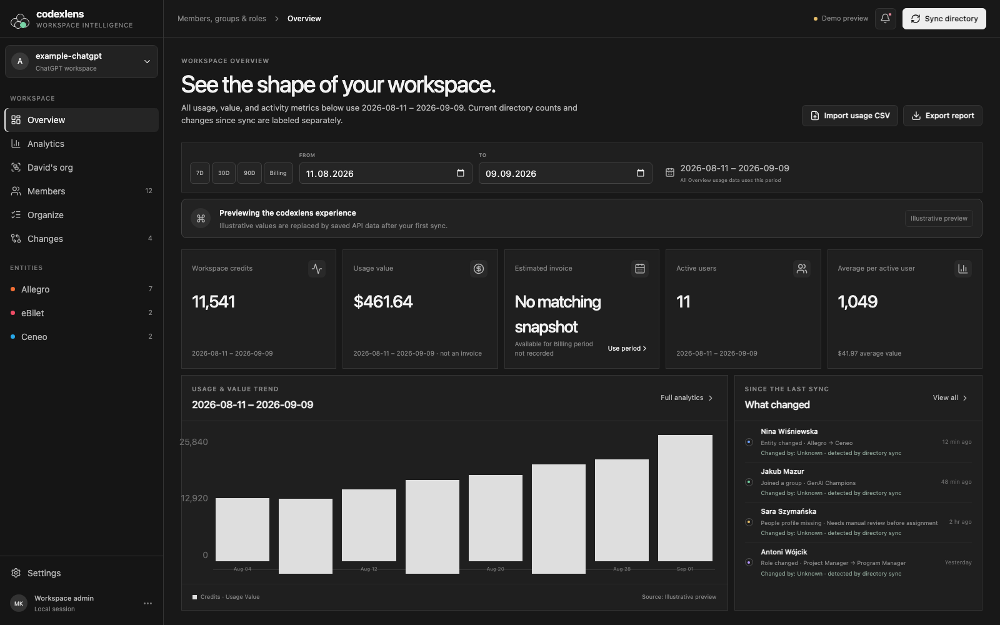
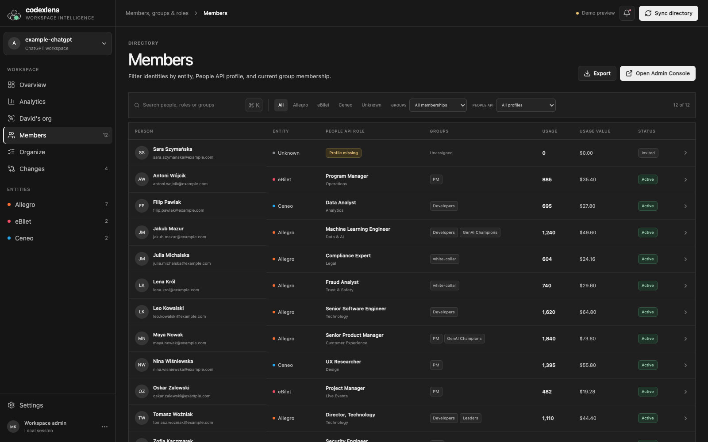

# codexlens

`codexlens` is a locally runnable workspace control surface for ChatGPT members,
groups, People API enrichment, entity reporting, usage imports, and change
notifications.

The interface deliberately follows the restrained, dark Admin Console visual
language while using a bubble-cluster mark to represent overlapping groups.

## Why codexlens exists

OpenAI's Admin Console is the source of truth for workspace access and billing,
but a budget or access owner still has to join several operational views by
hand. It does not combine the company's people hierarchy with Codex usage,
explain attributed usage by management subtree, reconcile job-title and email-domain
assignment rules, or preserve a simple “what changed since my last sync”
view in one place.

Codexlens closes that manageability gap without replacing OpenAI's controls. It
adds a local decision and reporting layer around the Admin APIs and People API:

- explain attributed workspace usage and OpenAI usage estimates by person, group, entity, and direct-manager subtree
- reconcile every management usage allocation to 100% of the selected workspace usage
- reconcile one regular group per person using email domains and People API job titles
- assign special groups to individual people and track local OpenAI role–group plans
- identify ungrouped users, missing profiles, overlapping assignments, and
  directory changes before acting
- keep credentials and synchronized personnel data local

## Screenshots

All screenshots below use fictional demo users and synthetic values. They do
not contain synchronized workspace, personnel, billing, or credential data.





## What works

- synchronizes members and groups from a workspace-scoped ChatGPT Admin API key
- enriches each member from People API by exact email match
- separates Allegro, eBilet, Ceneo, and unresolved entity records
- shows missing People API profiles before other members
- manages manual group membership with confirmation and post-write verification
- prevents edits to groups identified as SCIM-managed
- provides **Organize** with exact email-domain rules taking precedence over
  People API job-title rules; previews both removals and additions before applying
- splits each People API job-title rule into inside/outside the verified David Roberts
  reporting structure when both populations exist; the manager is included, legacy
  unsplit rules remain defaults, and unresolved hierarchy blocks scoped assignments
- preserves special `admin` and `cat-team` memberships during regular-group moves,
  with separate, explicitly confirmed per-member controls for these special groups
- provides opt-in local background sync with visible status, failures and change counts
- stores snapshots locally and reports field-level changes between syncs
- records who added a member when the upstream directory explicitly returns an
  inviter, identifies SCIM provisioning, and marks unavailable actors as unknown
- synchronizes daily per-user credits and OpenAI USD usage estimates from the unified Analytics API, covering ChatGPT Work and Codex; falls back to Codex-only Analytics if unified access is unavailable
- retains former users' historical usage in workspace totals and avoids double-counting overlapping Codex-only history
- imports normalized per-user usage CSV files as a fallback and calculates workspace, group,
  entity, and active-user averages without double-counting workspace totals
- stores a configurable fallback price per credit and shows attributed usage value for the
  workspace, every member, entity, group, and active-user average
- stores a manual point-in-time OpenAI Billing snapshot for current balance and unbilled
  overage, separately from period usage
- provides daily, weekly, and monthly analytics with custom date ranges plus
  entity and group filters
- displays OpenAI-provided attributed USD usage estimates for the selected period,
  person, group, and entity; never labels them as issued invoice charges
- supports a billing-cycle budget, configurable alert threshold, and workspace
  overage limit; budget targets are prorated to unfiltered selected periods
- compares every selection with the immediately preceding equal-length period,
  forecasts open-period usage value, and shows daily value pace, planning budget variance, adoption,
  top-user concentration, median/P90 user cost, and directory exceptions
- switches the trend between attributed usage value and raw usage,
  and shows value, share, and value-per-active-user for users, groups, and entities
- keeps every usage metric on Overview within one clearly selected period,
  defaulting to the saved Billing period when available
- filters Members by current group, no group, multiple groups, and People API
  profile status
- provides a dedicated **Management** tab that defaults to David Roberts but can
  search People API managers by name or email, then shows each selected
  manager's direct teams, reporting subtrees, workspace usage fraction, and
  attributed usage value
- clearly labels demo, saved, and live data states
- records local role–group plans and explicit manual confirmation of assignments
  made in OpenAI Admin; does not infer effective permissions
- shows current headcount, workspace coverage and period activity for the N-1
  structures alongside David Roberts in **Analytics → N-1 coverage**

## Reviewing access

The three access-management screens are **Members & groups**, **Organize**, and
**Permissions & roles**. Overview, Analytics, Management and Changes remain available.

**Members & groups → People** shows regular and special memberships separately.
Filter by no groups, special groups only, one regular group, multiple regular
groups, rule differences, profile issues, current group, entity or job title.
The **Status** dropdown matches the table badges: **Conflict**, **Needs regular
group**, or **One regular group**. Combine it with the other filters to isolate
conflicts; changing it clears the bulk selection. This is membership status, not
the account's Active/Invited/Inactive state. **Clear filters** resets it too.
Counts reflect the latest directory snapshot, not historical membership or a usage period.

Each person should have exactly **one regular group**. Ceneo and eBilet are normal
regular groups. `admin` and `cat-team` are special groups, identified by their
case-insensitive names; either or both can coexist with a regular group. Open a
member and use **Special groups** to review an individual assignment or removal.
Membership in a group named `admin` is distinct from the built-in OpenAI Admin role.
The **Groups** view lists membership and conflicts and can create empty manual
groups; group renaming/deletion and externally managed groups stay in OpenAI Admin
or the authoritative identity provider.

**Organize** uses this precedence: specific-person exception → exact workspace email domain → manager’s
reporting structure → People API job title → manual review. A person exception
uses the workspace member ID and may choose any manually managed group. A regular
destination replaces other regular memberships on confirmation; an `admin` or
`cat-team` destination is added without removing regular memberships. Domains are normalized and matched exactly, never by
substring or entity label; add each intended domain explicitly. Only matched,
fresh People API profiles qualify for job-title rules. Domain rules are independent
of People API availability. Each enabled rule selects one manual regular group.
Existing additive/entity rules must be reviewed and saved as version 2 before
they can be applied; saving retires legacy entity rules but changes no memberships.

When reviewing more than 100 members, CodexLens splits the selection into
sequential batches of at most 100. Each batch has its own fresh preview and
explicit confirmation; a partial or uncertain write stops the remaining batches.

Under **Manager’s structure → regular group**, search People API by name/email,
select the specific manager, choose a regular group, and add the rule. Save rules,
then use **Review people** to preview and confirm the proposed changes. Rules
include the selected manager and all direct and indirect reports. Managers need
not have a Codex account for their reports to match; the manager is included only
if they are also an eligible workspace member. If structures overlap, the manager’s
own rule wins for that manager, then the nearest configured ancestor wins,
regardless of rule order. Email-domain rules still take precedence. Display names are labels; stable People API IDs
determine the reporting chain. Existing version-2 rules need no migration.

Search **People API job title** by one or more words (case/accent insensitive),
choose a bulk destination such as `DataEngineers`, and assign all visible
title/Tech or Non-tech rows in the draft. Search, domain, N-1, segment and
**Rule / assignment** filters define the visible rows; review them before saving.
The last filter distinguishes rows with no effective title rule from rows with
people who currently have no regular group, and can show either condition.

**Add structure rule** adds to the draft, not the database. Organize and Permissions
editors retain drafts (including unfinished inputs) across sidebar tabs in the
current page session. Organize also keeps an unsaved browser-local backup and
offers **Download draft backup** / **Restore draft backup**. **Save rules**
persists assignment rules; unsaved drafts show a save bar and trigger a browser
warning before reload/close. Drafts are not applied to OpenAI automatically.

Structure matching requires unique exact email matches and active People API
profiles. Missing profiles, ambiguous identities, cycles, incomplete paths, or
an unavailable configured manager block structure evaluation and job-title
fallback, rather than guessing. Domain rules and explicit manual moves remain
independent. Use **Refresh structures** to reload the preview context. Both the
server preview and confirmation fetch fresh hierarchy data; a reporting-line
change invalidates the preview before any group write. Auto-sync still only
refreshes data—it never applies these rules.

Select people and preview the before/after state, including removals, additions,
and retained special memberships. Regular moves replace regular groups but never
remove special ones. SCIM/dynamic groups are read-only. Previews expire after ten
minutes, are single-use, and are rejected if directory, reporting structure, rules or live membership
changed. Writes require explicit confirmation, are checked against live OpenAI
membership and verified afterwards. Verified changes use the Changes audit trail.
Batches are limited to 100 people and stop on the first uncertain write. They are
not atomic: sync and review again after partial results; no write is automatically
retried or rolled back. Demo mode does not permit access writes.

## Filtering change history

In **Changes**, use **Change area → People API changes** to review job-title,
department, manager, entity and recorded profile events separately from OpenAI
workspace changes. **Change type** narrows the selection to a specific event,
such as manager changes, OpenAI role changes, joining or leaving a group, or
member additions/removals. Counts reflect all saved history, with 50 matching
events per page; filtering happens before pagination, not just within the
dashboard's latest 100 events. **Clear filters** restores the full history.

Classification uses exact saved action labels, not actor identity or guesses
from the free-text details. Ambiguous older labels stay **Other / unclassified**.
Entity is an enrichment field and may use an email-domain fallback. These are
snapshot differences detected during synchronization, not an authoritative
upstream audit log. Filtering neither changes permissions nor marks events read.
**Mark all read** still applies to the entire history, including hidden events;
demo mode is read-only.

## OpenAI permissions and roles

**Permissions & roles → Current OpenAI configuration** shows a read-only snapshot
of workspace roles, permission states (including inheritance), and API-reported
group–role assignments. Browse by group or role, search, filter groups without
reported roles or with multiple roles, and open each role's permission details.
Manual directory sync and enabled auto-sync refresh this snapshot. **Refresh from
OpenAI** imports just roles and assignments without waiting for People enrichment
or usage history. Last attempt and last successful import are displayed separately.
If any role/group request fails, the last complete snapshot is retained and marked
stale; partial results never replace it. This does not compute effective member
permissions or import direct user grants.

**Local mapping plan** remains a separate planning view, not upstream role
definitions. Register the name (and optional ID) of a role that already exists in
OpenAI Admin, then assign groups in the **By role** or **By group** view. Review
the before/after mapping before saving. Saving does not change OpenAI permissions.

After making the corresponding assignments in OpenAI Admin, explicitly record
manual confirmation. Its timestamp is an operator attestation, **not API
verification**; later changes are marked pending again. Affected-person counts
are unique current group members, not a calculation of effective permissions.
Role definitions, permission editing and actual role assignments stay in OpenAI
Admin. Imports never overwrite local plans or automatically confirm them. An empty
local plan means no local references were registered, not that OpenAI has no roles.
Import uses the configured ChatGPT workspace Admin key with read access to
`GET /manage/workspaces/{workspaceId}/roles` and
`GET /manage/workspaces/{workspaceId}/groups/{groupId}/roles` under
`https://api.chatgpt.com/v1`. API Platform organization/project role endpoints are
not used as a substitute. No upstream role/group-assignment write is implemented
by this import feature; write-permission checks are a separate future step.

## Auto-sync

`npm run dev` and `npm start` launch the app plus a local sync runner bound to
`127.0.0.1`. Auto-sync is **paused by default**. Open the top-bar **Auto-sync**
control to enable it and choose 5, 15 (default), 30, 60 or 240 minutes. The runner
continues while the local server is running, even with the browser closed; it
does not run while the computer or server is stopped. Restart the server after
upgrading to this version to start the runner.

Scheduled sync refreshes the directory and, at most once per hour after a
successful usage import, fetches the last seven days of usage to catch revisions.
Use **Sync directory** for the full configured history backfill. Status shows
last success, next run, errors, runner availability and detected changes. People
API failures retain last-known enrichment fields and mark the profile stale;
directory snapshots are saved atomically. Sync and membership operations share
a renewable lock. Auto-sync **never applies assignment rules, changes group
membership, edits roles or updates the manual billing snapshot**.

The worker authenticates with a process-generated token, never saved to `.env`
or returned to the browser. The app is a local administration tool, not a
multi-user or public server; do not expose its port to the internet.

## N-1 structure coverage

Open **Analytics → N-1 coverage**. The reference leader defaults to David Roberts
(`MANAGEMENT_LEADER_NAME`). People API identifies that leader's parent; each of
the parent's direct reports is one N-1 row. The full directory is traversed by
stable manager IDs, not just the direct reports returned by `/employees`.

- **People**: current `isActive=true` profiles in the entire structure, including
  the active leader and contractors. An inactive leader's active descendants
  remain counted. Rows do not overlap; the parent is outside the rows.
- **In workspace / coverage**: currently accepted OpenAI members matched to
  unique People API emails, and their percentage of the structure's headcount.
  Unmatched, ambiguous, duplicate and inactive profiles are explicitly excluded.
- **ChatGPT / Codex-only seats**: the product seat type OpenAI actually reports.
  Unknown types are shown separately. A ChatGPT seat does not prove or disprove
  Codex feature access; effective custom permissions are not available here.
- **Active in period**: members with nonzero imported usage or turns in the
  selected dates, with the usage source shown. This is observed activity, not a
  permissions count or proof of inactivity where history is missing.

Entity filters affect both numerator and denominator. Group filters narrow only
workspace members and activity; nonmembers have no workspace group, so People
API headcount stays unchanged. Dates affect activity only: current headcount and
membership must not be interpreted as historical access. Source timestamps and
broken reporting paths are visible. People API is cached in server memory for up
to ten minutes; this view does not save the full company directory locally.

## Run locally

Requirements: Node.js 22.13 or newer.

```bash
npm install
cp .env.example .env.local
npm run dev
```

Open [http://localhost:3000](http://localhost:3000).

Use [http://localhost:3000/?demo=1](http://localhost:3000/?demo=1) for a
non-persistent preview containing only fictional records.

On this machine, `.env.local` is an ignored symbolic link to the previously
created private environment file. The admin key is not committed.

## Environment

Create a workspace-scoped Admin key in Admin Console with only the permissions
needed by your workflow:

- Users: Read
- Group Management: Read for sync, Write for membership changes
- Enterprise analytics API: Read (`enterprise.analytics.usage.read`) for the unified ChatGPT Work and Codex usage feed
- Codex analytics API: Read (`codex.enterprise.analytics.read`) only for the older Codex-only fallback

The minimum local configuration is:

```dotenv
CHATGPT_ADMIN_KEY=your_workspace_admin_key
CHATGPT_WORKSPACE_ID=your_workspace_id
CHATGPT_WORKSPACE_NAME=your_workspace_name
CODEX_ANALYTICS_HISTORY_DAYS=365
PEOPLE_API_BASE_URL=https://people.allegrogroup.com
MANAGEMENT_LEADER_NAME=David Roberts
```

`CHATGPT_ADMIN_KEY` is read only by server routes. Never prefix it with
`NEXT_PUBLIC_`, and never commit `.env.local`.

## Credential and data safety

- `.env*` is ignored except for the placeholder-only `.env.example`.
- `.wrangler/`, exports, build output, and local SQLite/D1 state are ignored.
- Admin keys are consumed only in server routes and are never returned to the
  browser or written to application logs.
- The repository contains synthetic demo identities only; screenshots must be
  captured through `?demo=1`.
- Before publishing, scan both the working tree and Git history for API-key
  patterns and workspace data. Rotating a key remains mandatory if it was ever
  committed, even if history is later rewritten.

## Usage data

Each **Sync directory** run also requests daily, per-user credit usage from:

```text
GET /v1/analytics/codex/workspaces/{workspace_id}/usage
```

The Admin key must belong to the selected workspace and include **Codex
analytics API: Read**. Sync loads the previous 365 days by default; set
`CODEX_ANALYTICS_HISTORY_DAYS` to a value from 1 through 3650 to change the
window. The API's cursor pages are followed automatically, and existing daily
rows are updated rather than duplicated.

If the analytics permission is missing, directory sync still succeeds and the
result banner explains the analytics failure. As a fallback, **Import usage
CSV** accepts these columns:

```csv
email,period_start,period_end,credits,messages
person@example.com,2026-08-01,2026-08-31,1240,290
```

Use `tokens` instead of `credits` for token reports, or `cost` for USD. A `unit`
column can override the inferred unit. Unmatched emails are counted and skipped.

Set the contract-specific **price per credit** and reporting currency from the
Settings panel. Codexlens calculates:

```text
usage value = attributed credits × price per credit
```

New installations default to **$0.04 USD per credit**. The value remains
editable and is stored locally for the workspace.

The unified Analytics API provides `totals.credits`, `totals.cost_usd`, and
`totals.estimated_cost_usd` per user per UTC day. Codexlens uses reported USD
cost when supplied, otherwise the OpenAI USD estimate. Only older Codex-only
credit rows fall back to credits × the configured price. The dollar basis is
shown in Analytics. None of these values is an issued invoice; committed-credit
offsets, overage, contracted rates, adjustments, and billing-cycle timing can
make payable spend different. The manual overage snapshot is dated and never
allocated across users or groups. Token imports remain unpriced because a
credit price cannot be applied to tokens.

Unified rows replace overlapping Codex-only or credit CSV rows for the same
user and day in reads; older history remains available where unified data is
absent. Historical usage by removed workspace members stays in workspace totals
but is shown as former/unassigned because current People API roles, entities,
groups, and managers cannot be inferred for their old activity. Current group
membership can overlap, so group subtotals must not be added together.

If imported rows contain direct USD `cost`, Analytics treats them as USD usage
value rather than credit valuation. A configured billing-cycle
budget is a planning target for the saved Billing period. Unfiltered selections
receive a day-prorated target; filtered group and entity views show contribution
only and deliberately do not invent separate budgets.

The Analytics view supports custom date ranges, 7/30/90-day and month-to-date
presets, group and entity filters, daily/weekly/monthly buckets, budget and cost
KPIs, equal-period comparisons, open-period forecasts, finance signals, and
breakdowns by person, role, group, and entity. The role split groups People API
titles into Data, Software, Product, Design, and Other job families. Each
imported row is assigned
to the bucket containing its `period_end`. For accurate daily analytics, import
one row per user per day; wider source periods are flagged instead of being
silently spread across days.

The **Management** view defaults to the configured `MANAGEMENT_LEADER_NAME`
(`David Roberts` by default) and allows another People API person to be selected
by stable ID. Search accepts partial names, omitted Polish accents, email, and
small typing errors; the full directory fallback stays server-side and is
cached briefly. Each selected person's direct report is treated as a usage owner.
Codex users are walked up the full People API manager chain, so teams still roll
up correctly when an intermediate manager does not have Codex access. Each
team's workspace share is its attributed usage divided by total workspace usage
for the same period. The displayed USD value sums source-provided per-user
estimates; it is not a share of the payable invoice. An explicit outside-
selected-teams/unresolved row reconciles the table to 100% of workspace usage
and attributed value rather than silently dropping people. The remainder also includes
the selected manager's own usage when that person is a current Codex member.
The current People API reporting structure is used for historical usage, so
historical org-chart snapshots are not inferred.

API `turns` are stored in the existing activity-count field used by the UI's
message counters. Workspace-level aggregate rows are never spread across users;
only rows carrying a member ID or email are attributed.

## Addition attribution

Codexlens stores `added_at`, inviter name, inviter email, and attribution source
when the workspace user response explicitly provides those fields. SCIM-managed
members are labeled as identity-provider additions. If the directory endpoint
does not return an actor, Codexlens shows **Unknown — not provided by directory
API**; it never infers an inviter from the person who happened to run a later
sync.

For complete historical attribution, an Enterprise Compliance API collector is
the appropriate future source, subject to the event coverage and retention of
the workspace. Existing snapshot events predate actor capture and remain labeled
as legacy events.

The workspace total sums each person once. Group totals can overlap because one
person may belong to several groups, so group totals must not be added together
to reconstruct the workspace total.

## Group organizer

Use **Organize** to explicitly configure job-title defaults such as:

- product management, UX, research, program, project, and process management → PM
- software, data, machine learning, engineering, platform, QA, IT, and analyst roles → Developers
- fraud and compliance → white-collar
- security and cybersecurity → SEC
- missing, stale or ambiguous People API profiles → job-title rules blocked
- other matched roles → Review first, then choose a manual destination group

Rules are explicit saved decisions, not automatic job-family guesses. A
specific-person exception wins first, then an exact email-domain rule wins over
a structure rule, which wins over a job-title rule. Automatic rules result in one
regular destination; an exception may add a special group instead.
Search the mapping tables and filter for missing, mapped, or conflicting legacy
targets. Review people against the last saved rules before confirming a move.

**Shared email domains cannot distinguish entities.** A rule for a shared domain
affects every matching member regardless of their People API entity. Use a manager’s
structure rule (without a conflicting domain override) or a manual per-person
assignment when the email domain cannot express the intended split;
the app does not silently fall back to entity-label overrides. See **Reviewing
access** above for migration, special groups, previews and partial-write behavior.

## Data and safety model

- Durable local state uses the project-local D1/SQLite emulator under
  `.wrangler/`; it is ignored by Git.
- The first sync establishes a baseline and creates no noisy “everyone joined”
  events. Later syncs compare role, department, manager, entity, workspace role,
  status, People API profile availability, and group membership.
- Change events keep actor provenance. Changes made inside Codexlens retain the
  signed-in ChatGPT identity when hosting headers are available; a local session
  is explicitly shown as an unknown local admin.
- Remote writes are limited to explicit, confirmed manual group membership and
  supported built-in workspace role changes. Each is verified by a fresh read.
- SCIM-controlled membership remains owned by the identity provider.
- Production credentials and locally synchronized people data are not part of
  the repository.

## Reporting semantics

OpenAI's unified Daily Usage Analytics API supplies workspace-scoped daily
credits and per-user USD estimates across ChatGPT Work and Codex. The older
Codex-only endpoint is a fallback. Neither is a raw audit-event feed or an
invoice. In Codexlens, Analytics API and attributed CSV rows describe usage;
the manually recorded Billing snapshot describes a current balance, not an
invoice reference for historical dates; People API supplies organizational
dimensions.

Committed credits, consumed credits, unbilled overage, a planning budget, and an
issued invoice are intentionally separate. Reports can lag, so reconciliation
should always compare the source timestamp and exact billing period. Usage and
cost are operational indicators; they do not by themselves establish business
value or savings.

## Commands

```bash
npm run dev          # local app
npm run build        # production build
npm start            # run the built worker locally, with the sync runner
npm run lint         # code quality
npm test             # build and app-level checks
npm run db:generate  # regenerate schema migrations
```

See [docs/architecture.md](docs/architecture.md) for the system boundaries and
next implementation increments.

This repository contains the application source, not a GitHub Pages build.
Codexlens requires server-side secrets, API calls, and durable local data, which
cannot be provided safely by a static GitHub Pages deployment.

## OpenAI references

- [Managing Admin keys in Admin Console](https://help.openai.com/en/articles/20001407-managing-admin-keys-in-admin-console)
- [Workspace analytics for ChatGPT Enterprise and Edu](https://help.openai.com/en/articles/10875114-user-analytics-for-chatgpt-enterprise-and-edu-public-beta)
- [Unified Analytics API and access](https://learn.chatgpt.com/docs/enterprise/analytics-api)
- [ChatGPT Work usage and cost](https://learn.chatgpt.com/docs/enterprise/chatgpt-work-usage-and-cost)
- [Compliance API and audit events](https://learn.chatgpt.com/docs/enterprise/compliance-api)
- [Groups in ChatGPT Enterprise and Edu](https://help.openai.com/en/articles/9083985-groups-in-chatgpt-enterprise-and-edu)
